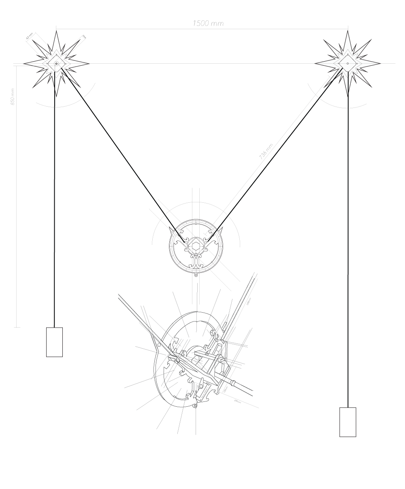

# [Skylines I](http://www.patriciogonzalezvivo.com/2014/skylines/)

Drawing machine that slowly reveals an image of the world viewed through the tireless eye of technology. It constantly adds traces of material, demonstrating that the drive for immediacy is not inherent in technology.

These projects were part of an ongoing [process](http://www.patriciogonzalezvivo.com/2014/skylines/process.php) of investigation during my last year as a Parson's MFA DT student and they are presented as three explorations around the theme of skylines.

We look at the horizon and see a _skyline_, the place where the earth and sky touch. This contour is the confluence of time and space. The landscape is in constant change and fluctuation; it is shaped over time by forces like erosion and human desire. This skyline is also defined by the particular position of the observer - seeing through technical devices allows us to look beyond our perception into different qualities of time and space.

